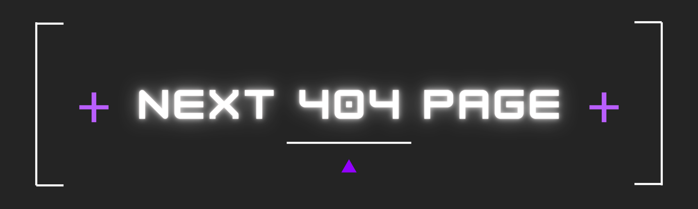

<div align="center">

<h1>Next 404 Page</h1>



<br />

A customizable 404 page built with Next.js, designed to provide a user-friendly experience for visitors who encounter a 404 error on a website.

[](#license)
[](#overview)
[](#overview)

<!-- Optional GitHub badges -->
<!-- Replace USERNAME and REPOSITORY -->

[](https://github.com/hadzicni/next-404-page/releases)
[](https://github.com/hadzicni/next-404-page/stargazers)
[](https://github.com/hadzicni/next-404-page/issues)
[](https://github.com/hadzicni/next-404-page/commits)

<br />

[Quick Start](#installation) ·
[Features](#features) ·
[Usage](#usage) ·
[Contributing](#contributing)

</div>

## Table of Contents

- [Overview](#overview)
- [Tech Stack](#tech-stack)
- [Features](#features)
- [Prerequisites](#prerequisites)
- [Installation](#installation)
- [Configuration](#configuration)
- [Usage](#usage)
- [Development](#development)
- [Build and Deployment](#build-and-deployment)
- [Security](#security)
- [Contributing](#contributing)
- [Maintainers](#maintainers)
- [Contact](#contact)
- [License](#license)

## Overview

This project is a 404 page built with Next.js. It provides a user-friendly and visually appealing experience for visitors who encounter a 404 error on a website. The page is designed to be responsive and customizable, allowing developers to easily integrate it into their Next.js applications.

## Tech Stack

| Category   | Technology                  |
| ---------- | --------------------------- |
| Framework  | Next.js                     |
| Language   | JavaScript / TypeScript     |
| Styling    | CSS / Tailwind CSS / Shadcn |
| Deployment | Docker                      |

## Features

- Customizable design and layout
- Responsive and mobile-friendly
- Easy integration with Next.js applications
- Support for both JavaScript and TypeScript
- SEO-friendly and accessible

## Prerequisites

- Node.js (24 LTS or higher)
- npm or yarn package manager
- Docker (optional, for containerization)

## Installation

### 1. Clone the repository

```bash
git clone https://github.com/hadzicni/next-404-page.git
cd next-404-page
```

### 2. Install dependencies

```bash
npm install
# or
yarn install
```

### 3. Start the project

```bash
npm run dev
# or
yarn dev
```

## Configuration

To customize the 404 page, you can modify the following files:

- `not-found-scene.tsx`: Main component for the 404 page
- `globals.css`: Styles for the 404 page

## Usage

To use the 404 page in your Next.js application, follow these steps:

1. Copy the `not-found-scene.tsx` component to your project.
2. Import and use the component in your custom `_app.js` or `_app.tsx` file.
   Example:

```jsx
import NotFoundScene from './path/to/not-found-scene';
function MyApp({ Component, pageProps }) {
  return (
    <>
      <Component {...pageProps} />
      <NotFoundScene />
    </>
  );
}
export default MyApp;
```

## Development

For development, you can run the project in watch mode:

```bash
npm run dev
# or
yarn dev
```

This will start the development server and automatically reload the page when you make changes to the code.

## Build and Deployment

To build the project for production, run:

```bash
npm run build
# or
yarn build
```

## Security

If you discover a security vulnerability, please do not open a public issue.

Instead, report it privately:

- Email: nikolahadzic7@icloud.com
- Maintainer: Nikola Hadzic

We will investigate and provide updates as quickly as possible.

### Supported Versions

| Version        | Supported |
| -------------- | --------- |
| Latest         | ✅        |
| Older versions | ❌        |

## Contributing

Contributions are welcome. A possible workflow:

1. Create a fork
2. Create a feature branch
3. Implement your changes
4. Run tests and linting
5. Open a pull request

## Maintainers

<!-- Duplicate the <td> block for additional maintainers -->
<table>
	<tr>
		<td align="center" width="180">
			<a href="https://github.com/nikolahadzic">
			    
			    <br />
			    <strong>Nikola Hadzic</strong>
			</a>
			<br />
			Core maintainer
		</td>
	</tr>
</table>

## Contact

- Contact person: Nikola Hadzic
- Email: nikolahadzic7@icloud.com
- Project page: https://github.com/hadzicni/next-404-page

## License

This project is licensed under the MIT License.

See [LICENSE](LICENSE) for details.
